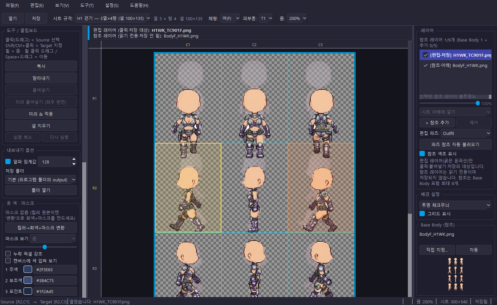

# 🟦 SpriteGrid Editor

> 도트 스프라이트 시트를 **셀 단위로 복사·반전·붙여넣기·지우기** 하고, (2단계부터) 컬러 옷 시트를
> **회색 원본 + 인덱스 마스크(`_M`)** 로 변환해 Unity 에 바로 넣을 PNG 로 내보내는 독립 실행형 데스크톱 툴.
> 모든 편집·확대·저장은 최근접 이웃(Nearest)만 사용해 도트가 뭉개지지 않는다.

기획서: 볼트 `에디터 툴 제작\EDT-ETC.6 스프라이트 시트 편집기 SpriteGrid Editor 기획서 v1.1.md`
스택: Python 3 + PySide6(Qt) + Pillow + NumPy



## 📌 주요 기능 (V0.3.0)

### 🖌 마스크 보정 · 쌍 작업 (3단계)
- **마스크 경계 보정 브러시** — 연필 · 채우기 · 사각형 · 번호 교체 · 지우개, **알파 보호**, 적용 범위(현재 셀 / 선택 셀 / 시트 전체), 획 단위 실행 취소
- **셀 간 마스크 복사** — 마스크만 Target으로 / 같은 행 전체로 (그림은 그대로)
- **F/M 쌍 작업 모드** — 반대 체형 새 문서로 복제하고 원본을 읽기 전용 참조(나란히 / 겹쳐보기)로 두고 위치를 다시 맞춤
- **파츠 참조 레이어** — 편집 파츠 기준으로 Eyes/Outfit/Hair/Helmet/Weapon 참조를 §7 합성 순서대로 위/아래 배치, `Allies/<파츠>/` 자동 불러오기


### 🎨 회색 + 마스크 (2단계, V0.2.0)
- **컬러 → 회색 + 인덱스 마스크(`_M`) 자동 변환** — 색 기반 Lab k-means(영역 수 1\~4, 스포이트 대표색 보정) / 수평 분할 / 회색만
- 밝기 정규화(0.42\~1.0, 중앙값 0.72, CHR-ART.5 §3.1), 잡티 정리, 알파 보호
- 마스크 보기(오버레이 / 마스크만), 누락 픽셀 강조, **캔버스 색 미리보기**(Unity 셰이더와 같은 `회색 × Gain × 색`)
- **프리셋 4색 비교**(+스쿼드색, 음영 범위·밝기 하한 경고), **마스크 영역 통계**(셀별·일관성 검사)
- **Nudge** — 셀 안에서 내용 1px/5px 이동 (Alt+방향키)
- 저장 시 `_M.png`(8비트 L, Unity R8) 함께 저장 + 저장 전 검증, 열 때 `_M.png` 자동 불러오기

### 📥 이미지 가져오기 (A1111 · Gemini 출력 정리)
- 열기 / 끌어다 놓기 시 **크기·배경을 자동 계산하는 팝업** — 원본 크기, 배경(투명 / 단색 `#RRGGBB` / 단색 아님) 표시
- 크기: **자동 조정(비율 유지, 기본)** — 가로만 바꿔도 세로가 따라감 / **사용자 지정** — 가로·세로 직접 입력, 시트 규격에 맞추기·원본·50%
- 시트 규격 크기로 **투명 여백·잘라내기** → 그리드와 Base Body가 바로 맞음
- 배경 투명: 자동(테두리 색) / **지정 색**(원본 미리보기 클릭 또는 색 선택), 허용 오차, 가장자리와 이어진 부분만 / 같은 색 전부
- 열린 시트에도 `도구 → 이미지 크기·배경 조정…`(Ctrl+Shift+I)

### 🖼 캔버스
- 줌 100\~800% (정수 배율, **보간 없음**), 휠 클릭 드래그 / Space+드래그 이동, 그리드 오버레이(G)
- 셀 선택: 클릭 = Source, Shift/Ctrl+클릭 = Target, 드래그 = 다중 셀 범위
- 배경: 투명 체크무늬 / 흰색 / 검은색 / 도트 격자 (B 순환)
- **편집 레이어 vs 참조 레이어 구분** — 캔버스 위 레이어 바 + 우측 레이어 목록(`[편집·저장]` / `[참조·위/아래]`), 편집 시트는 굵은 윤곽선, 참조는 색조 표시·읽기 전용
- **참조 레이어 최대 6개** (Base Body 1 + 추가 PNG 5). 레이어별 눈(표시)·불투명도·위/아래 위치. 편집 레이어는 항상 1개(현재 시트)
- 테마 6종: 다크 / 라이트 / 오렌지(아이콘) / 미드나잇 블루 / 포레스트 그린 / 고대비

### ✂ 셀 편집
- 복사 / 잘라내기 / 붙여넣기 / **미러 붙여넣기** / 상하 반전 / **미러 & 적용** / 셀 지우기
- 임의 셀 ↔ 임의 셀, 한 행 전체 같은 다중 셀 한 번에 처리 (미러는 셀마다 반전)
- Undo / Redo 100단계

### 📐 시트 규격 · 체형
- H1 걷기 3열×4행(셀 100×135), H2 전투 6열×5행(셀 256×256), 임의 설정, 사용자 프리셋, 이미지 크기로 자동 선택
- 체형 여(F)/남(M)/공용 — Base Body 자동 매칭, 파일명 접미사 검증, 다른 체형 붙여넣기 경고, 파일명 도우미

### 💾 저장
- PNG(RGBA) 전용, 알파 임계값(기본 128), 투명 픽셀 RGB (0,0,0), 덮어쓰기 시 `_backup.png` 보관
- 저장 폴더 지정 + 최근 폴더 10개, 기본은 프로그램 폴더 아래 `output/`
- 자동 저장(10분 · 2개) + 비정상 종료 후 복구

### 🌐 앱 공통
- 제목줄 `SpriteGrid Editor v0.3.0 - 파일명 *`, 도움말(사용법 F1 / 변경 내역 / 정보), 한국어·English, 테마 6종

---

## 📦 다운로드

[Releases](https://github.com/JEWANI/SpriteGridEditor/releases/latest)에서 `SpriteGridEditor_v0.3.0_win64.zip`을 받아 압축을 풀고
`SpriteGridEditor v0.3.0.exe`를 실행한다 (Windows 10/11 64bit, 설치 불필요).
압축 안에는 실행파일과 함께 `README.txt`(빠른 시작) · `CHANGELOG.md`(업데이트 내역) · `HELP_ko.md` / `HELP_en.md`(사용법)가 들어 있다.

> 서명되지 않은 실행파일이라 처음 실행할 때 Windows SmartScreen 경고가 뜰 수 있다 → `추가 정보` → `실행`.

---

## 🚀 실행 방법

### 소스로 실행
```bash
pip install -r requirements.txt
python main.py
```

### 실행파일로 빌드 (PyInstaller)
```bash
pip install pyinstaller
```
`실행파일 만들기.bat` 더블클릭 → `dist/SpriteGridEditor v0.3.0.exe` 생성 (버전은 `app_info.py` 에서 읽는다).
`locales/`, `HELP_*.md`, `CHANGELOG.md`, `icon.ico` 는 exe 안에 포함되고,
`config.json` · `autosave/` · `output/` 은 **exe 가 있는 폴더**에 만들어진다.

### 테스트
```bash
python -m unittest discover tests -v
```
(cell_ops · history · export_utils · 자동 저장 · i18n · 회색+마스크 변환 · 3단계 브러시/쌍 작업 단위 테스트 + 오프스크린 UI 스모크 테스트, 118개)

---

## 📁 파일 구성

```
SpriteGridEditor/
├── main.py                # 진입점 (QApplication, MainWindow)
├── main_window.py         # 메뉴/툴바/좌우 패널/상태바, 열기·저장·편집·자동 저장 흐름
├── app_info.py            # 이름·버전·코드네임·만든이·링크 상수 (단일 소스)
├── config_manager.py      # config.json (언어·테마·저장 폴더·최근 목록·프리셋·자동 저장) + base_dir/resource_path
├── i18n.py                # tr(), 언어 로드/전환, 폴백(en → ko → 키)
├── locales/ko.json, en.json
├── theme.py               # 테마 6종 QSS + 캔버스 색
├── canvas_widget.py       # 줌/팬/그리드/셀 선택/배경 레이어 (Nearest 렌더)
├── sheet_model.py         # 시트 RGBA 배열(NumPy), 그리드/셀 영역, 시트 규격 프리셋, 체형 인식
├── cell_ops.py            # 복사·붙여넣기·미러·클리어 (순수 함수)
├── history.py             # Undo/Redo (영역 스냅샷)
├── export_utils.py        # 알파 임계값, PNG 저장, 백업, 저장 폴더 결정, 파일명·시트 검증
├── autosave.py            # 자동 저장·크래시 복구 (autosave/)
├── reference_layers.py    # Base Body 탐색
├── layer_model.py         # 참조 레이어 모델·한도(최대 6개)
├── import_utils.py        # 가져오기 전처리: 배경 감지·투명화·비율 계산·리사이즈·시트 맞춤 (Qt 없음)
├── import_dialog.py       # 이미지 가져오기 팝업 (크기·배경)
├── mask_convert.py        # 회색·밝기 정규화·Lab k-means·마스크 후처리·틴트·통계·검증 (Qt 없음)
├── mask_tools.py          # 마스크 보정 브러시(연필·채우기·사각형·번호 교체)·마스크 복사 (Qt 없음)
├── pair_mode.py           # F/M 쌍 작업 · 파츠 합성 순서 (Qt 없음)
├── convert_dialog.py      # 컬러→회색+마스크 변환 창
├── compare_dialog.py      # 프리셋 4색 비교 창
├── stats_dialog.py        # 마스크 영역 통계 창
├── color_widgets.py       # 주/보조/포인트/패치 4색 입력 위젯
├── preset_dialog.py       # 시트 규격 임의 설정 / 프리셋 관리
├── save_dialog.py         # 저장 폴더·파일명 도우미
├── settings_dialog.py     # 환경설정 (일반/저장/시트/참조/자동 저장)
├── about_dialog.py, help_dialog.py, ui_utils.py
├── HELP_ko.md, HELP_en.md, CHANGELOG.md, README.md
├── icon.ico, requirements.txt, .gitignore, 실행파일 만들기.bat
├── tests/                 # test_core · test_i18n · test_import · test_mask · test_stage3 · test_ui_smoke
├── config.json            # (자동 생성, git 제외)
├── output/                # (자동 생성) 저장 폴더 미지정 시 기본 저장 위치 — git 제외
└── autosave/              # (자동 생성) 자동 저장본 — git 제외
```

---

## 🗺 로드맵

| 단계 | 버전 | 범위 |
| :--- | :--- | :--- |
| **1단계** | **V0.1.0** ✅ | 시트 열기/저장, 규격 프리셋, 그리드·줌, 셀 편집·다중 셀, Undo/Redo, 배경 레이어, 알파 임계값, 자동 저장, 공통 구성 |
| **2단계** | **V0.2.0** ✅ | 컬러 → 회색 + 마스크 자동 변환, 밝기 정규화, Nudge, 프리셋 색 미리보기·4색 비교, 마스크 통계, 저장 전 검증 (Unity 정비실 확인 대기) |
| **3단계** | **V0.3.0** ✅ | 마스크 경계 보정 브러시, 셀 간 마스크 복사, 마스크 오버레이, F/M 쌍 작업 모드, 파츠 참조 레이어 (실제 옷으로 사용 확인 대기) |
| 4단계 | V0.4.0\~ | 파일명 검증 강화, 배치 변환, 미러 제외 영역, `.meta` 복제 검토 |

*전체 변경 이력은 [CHANGELOG.md](./CHANGELOG.md) 참고.*

---

## 👤 만든이
재와니
